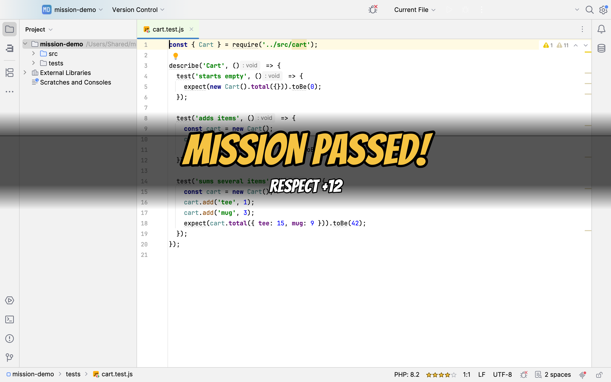

# Mission Passed


`app.heckit.ide.missionpassed` · Source: [GitHub](https://github.com/phse/mission-passed) · Support: [GitHub Sponsors](https://github.com/sponsors/phse) or [Ko-fi](https://ko-fi.com/phse_de)



Your JetBrains IDE, open-world style. A fan homage to the upcoming Grand Theft Auto VI:
green tests are a **MISSION PASSED!**, red ones get you **WASTED**, and every warning in your file raises your **wanted level**.

## Features

- **MISSION PASSED!** fades in over the IDE when a test run passes (with *RESPECT +* one per test) or a run configuration exits with code 0.
- **WASTED**: the IDE turns grey with a big red banner when tests fail or a run ends with an error exit code. Runs you stop yourself don't count.
- **Wanted level**: up to five stars in the status bar. Warnings (also weak ones) in the current file count one point, errors two.
- The banners ignore the mouse and disappear after a few seconds. If the IDE is in the background, the banner waits until you come back.
- Preview via *Tools | Mission Passed*, settings in *Settings | Tools | Mission Passed*.

## Installation

Install *Mission Passed* from the JetBrains Marketplace, or build the ZIP yourself and use *Install Plugin from Disk*.

## Build and run

```
./gradlew runIde        # sandbox IDE with the plugin
./gradlew buildPlugin   # ZIP in build/distributions
./gradlew verifyPlugin  # compatibility check
```

To use an installed IDE instead of downloading one, put `platformLocalPath=/Applications/PhpStorm.app` into `local.properties`.

## Regenerating the screenshots

`./gradlew runIde -Pscreenshots=<folder>` opens `marketplace/demo-project` in the sandbox and writes the steps from
`marketplace/screenshots.txt` as PNGs into the folder.

## Publishing

`./gradlew publishPlugin` with the Marketplace token in `PUBLISH_TOKEN` or `jetbrainsMarketplaceToken` in `~/.gradle/gradle.properties`.

## How it works

- Test runs: a project listener on `SMTRunnerEventsListener` (optional dependency on the Test Runner plugin).
- Other runs: an `ExecutionListener` looks at the exit code; runs stopped by the user are ignored.
- The banners are painted on the popup layer of the IDE frame and fade out by themselves.
- The wanted level counts the highlighters of the current editor after each daemon pass.

## License

Apache License 2.0, see [LICENSE](LICENSE) and [NOTICE](NOTICE). The bundled font Bangers is licensed under the SIL Open Font License 1.1.

Mission Passed is an unofficial fan project. It is not affiliated with, endorsed or sponsored by Rockstar Games or Take-Two Interactive.
Grand Theft Auto is a trademark of Take-Two Interactive Software, Inc.
